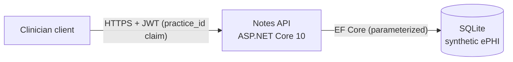
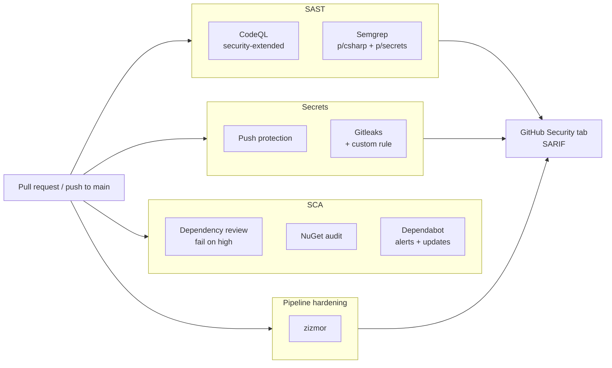

# Secure Notes API

A small, healthcare-style ASP.NET Core API that stores therapy session notes for multiple
independent practices, built to demonstrate an **end-to-end DevSecOps pipeline** on GitHub:
SAST, SCA, secret scanning, workflow hardening and supply-chain controls.

The repo tells one story:

1. **`main`** holds a secure, tenant-isolated API.
2. **[PR #1](https://github.com/NukPuNuk/secure-notes-api/pull/1)** deliberately introduces four
   realistic vulnerabilities, one commit each.
3. The **pipeline** runs on every PR. Some bugs are caught, some aren't.
4. **[docs/triage.md](docs/triage.md)** records how each finding was confirmed, rated *in context*
   and fixed, including what the tools missed and why.

> **All data in this repository is synthetic. No real PHI or PII.**

---

## Architecture



- **Multi-tenant:** every note belongs to a `PracticeId`. The tenant is taken from the **signed JWT**,
  never from the request.
- **Secure by default:** a fallback authorization policy requires an authenticated user on every endpoint
  unless one is explicitly marked `[AllowAnonymous]`.
- **Object-level authorization:** every query filters by the caller's practice. Cross-tenant requests
  return **404** (not 403), so the API doesn't reveal that a record exists.
- **No secrets in the repo:** the dev JWT signing key lives in .NET User Secrets, and the only connection
  string is a credential-free SQLite file path.

## Security pipeline



| Control | Tool | Where | Catches |
|---|---|---|---|
| **SAST** (data flow) | CodeQL, `security-extended` queries | [`codeql.yml`](.github/workflows/codeql.yml) | Injection and other source-to-sink flaws |
| **SAST** (patterns) | Semgrep `p/csharp`, `p/secrets` | [`security.yml`](.github/workflows/security.yml) | Insecure code patterns; custom rules are easy to write |
| **SCA** (pre-merge gate) | `dependency-review-action`, `fail-on-severity: high` | `security.yml` | Newly added vulnerable packages in a PR |
| **SCA** (build) | `dotnet list package --vulnerable --include-transitive` | `security.yml` | Vulnerable direct and transitive NuGet packages |
| **SCA** (ongoing) | Dependabot alerts, security updates, version updates with a 7-day cooldown | [`dependabot.yml`](.github/dependabot.yml) | Vulnerabilities in what's already on `main`; stale actions |
| **Secrets** | GitHub secret scanning + push protection | Repo settings | Known provider token formats, blocked before they reach the remote |
| **Secrets** | Gitleaks + [custom rule](.gitleaks.toml) for connection-string passwords | `security.yml` | Generic and provider secrets across git history |
| **Workflow security** | zizmor | `security.yml` | Unpinned actions/images, credential persistence, dangerous triggers |
| **Supply chain** | Every action pinned to a full commit SHA (pinact); container image pinned by digest; **SHA pinning enforced** in repo settings | All workflows | Tag-hijack attacks (tj-actions 2025, trivy-action 2026) |
| **Least privilege** | Read-only `GITHUB_TOKEN` by default; per-job `permissions:`; `persist-credentials: false` | All workflows | A compromised step being able to push code or read the token |
| **Runner monitoring** | StepSecurity harden-runner (egress audit) | `codeql.yml` | Unexpected outbound connections (secret exfiltration) |
| **Change control** | [`CODEOWNERS`](.github/CODEOWNERS) on `/.github/` | Repo | Unreviewed changes to the pipeline itself |
| **Disclosure** | [`SECURITY.md`](.github/SECURITY.md) + private vulnerability reporting | Repo | Coordinated disclosure path |

---

## The vulnerable PR

**[PR #1: DEMO: intentionally vulnerable changes](https://github.com/NukPuNuk/secure-notes-api/pull/1)**
is a draft that stays open permanently as evidence. **Do not merge.**

| # | Bug | Commit | Caught by | Missed by | Severity *in context* |
|---|---|---|---|---|---|
| 5.1 | **IDOR**: `FindAsync(id)` drops the tenant filter | `84879f7` | **Manual cross-tenant test only** | CodeQL, Semgrep, every CI check | **Critical** |
| 5.2 | **SQL injection**: `FromSqlRaw` with string interpolation | `f0064ec` | **CodeQL `cs/sql-injection`** (PR check failed); compiler warning EF1002 | Semgrep | **Critical** (tool said High) |
| 5.3 | **Vulnerable dependency**: Newtonsoft.Json 12.0.1 | `fc9098e` | **Dependency review** (failed + PR comment); **NuGet audit** (failed) | n/a | **Low** (tool said High) |
| 5.4 | **Hardcoded DB admin password** in `appsettings.json` | `aac24e7` | **Custom Gitleaks rule** (added after the miss) | Push protection, GitHub secret scanning, default Gitleaks, Semgrep | **Critical if real** |

**Default tools caught 2 of 4. With a custom rule, 3 of 4. The IDOR still needed a human.**

### What the results show

- **Scanners are a floor, not a ceiling.** The two misses were exactly the kinds that need humans:
  *business logic* (who may see which record) and *context* (is this string a credential?).
- **IDOR passed every scanner,** yet a practice-2 token read practice 1's patient notes with a `200`.
  A missing tenant filter isn't a data flow, so SAST has nothing to trace.
- **SQL injection in a multi-tenant app is a cross-tenant breach.** The query kept `PracticeId = 1`,
  but `%' OR 1=1 --` returned another practice's patient. That's why it was rated above CodeQL's "High".
- **A vulnerable package isn't automatically urgent.** Newtonsoft was never called (the API uses
  `System.Text.Json`) and the advisory is DoS-only, so it was rated Low, and removed anyway.
- **Four secret layers missed a human-style password.** A ten-line custom Gitleaks rule closed the gap.
  Prevention (User Secrets, Key Vault, managed identity) matters more than detection.

Full evidence, exploit requests and fixes are in **[docs/triage.md](docs/triage.md)**.

---

## Verification, not assumption

Several "green" results turned out to be wrong when checked. Finding these was part of the work:

| Looked fine | What was actually happening | Fix |
|---|---|---|
| Gitleaks: "no leaks found" | On push events it had scanned **1 commit**, not the history | Added `workflow_dispatch` for full-history scans (8/8 commits) |
| `dependabot.yml` committed | It was in the repo root, which GitHub **silently ignores** | Moved to `.github/`; confirmed coverage in Dependabot's run logs |
| Pinned `codeql-action` SHA "didn't match" its tag | **Annotated tags** have two SHAs (tag object vs. commit) | Confirmed the pin is the dereferenced, GitHub-verified commit |
| CodeQL: 0 alerts on `main` | Only meaningful once it had caught something | PR #1 proved it fires (alert #25) |

---

## Running locally

Requires the [.NET 10 SDK](https://dotnet.microsoft.com/download).

```bash
cd src/NotesApi
dotnet user-jwts create --claim practice_id=1   # prints a dev token
dotnet run --launch-profile https
```

```bash
curl -k https://localhost:7115/notes/1 -H "Authorization: Bearer <token>"   # 200: own practice
curl -k https://localhost:7115/notes/3 -H "Authorization: Bearer <token>"   # 404: other practice
curl -k https://localhost:7115/notes/1                                      # 401: no token
```

`dotnet user-jwts` stores the signing key in User Secrets, outside the repository.

---

## Known issues

- **F-5:** a validly signed token without a `practice_id` claim causes a 500 (with a stack trace in
  Development) instead of a 403. It fails closed, and the fix is documented in
  [triage.md](docs/triage.md#f-5-missing-claim-crash-and-verbose-error-output-found-on-main).

## Roadmap

- **DAST:** OWASP ZAP baseline scan, then an authenticated API scan driven by an OpenAPI spec
- **IaC:** insecure vs. secure Azure Terraform scanned with Checkov
- **Custom Semgrep rule:** flag any `db.Notes` query without a `PracticeId` filter (aimed at the IDOR class)
- **Threat model** (STRIDE + HIPAA technical safeguards) and a **leaked-secret incident playbook**
- **Enforcement:** branch ruleset requiring PR review and passing security checks on `main`
- **Provenance:** build attestations (`actions/attest-build-provenance`) and OpenSSF Scorecard
- **OIDC to Azure:** federated credentials, so the pipeline holds no stored cloud secrets

---

*All data in this repository is synthetic. No real PHI or PII. Built as a portfolio project.*
