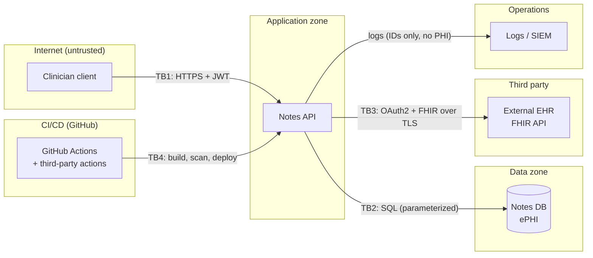

# Threat Model: Secure Notes API

**Method:** STRIDE per element of the data-flow diagram, plus a HIPAA Security Rule
technical-safeguard mapping. **Status** reflects what is actually implemented in this
repository today, including gaps. **All data is synthetic. No real PHI.**

| | |
|---|---|
| Version | 1.0 (2026-10-15) |
| Scope | Notes API (`src/NotesApi`), its database, the planned EHR integration, and the CI/CD pipeline |
| Out of scope | Client applications, Entra ID tenant configuration, physical/hosting controls |

---

## 1. System description

Clinicians at many independent therapy practices use the Notes API to read and search
session notes. Each practice is a **tenant**: a clinician must only ever see their own
practice's notes.

- **Notes API:** ASP.NET Core 10. JWT bearer authentication; the tenant (`practice_id`) is a
  claim in the signed token. A fallback authorization policy requires authentication on every endpoint.
- **Notes DB:** stores session notes (**ePHI**). SQLite in this demo; Azure SQL in a real deployment.
- **External EHR (planned):** the API would pull patient demographics over **FHIR** using
  SMART on FHIR / OAuth 2.0 client credentials.
- **Logs / SIEM (planned):** application and audit logs forwarded for monitoring.
- **CI/CD:** GitHub Actions builds and scans every change (see the [README](../README.md)).
  The pipeline is itself an attack surface: it runs third-party code with repository tokens.

### Assets (what we protect)

| Asset | Why it matters |
|---|---|
| Session notes (ePHI) | Confidentiality is a HIPAA obligation; disclosure is a reportable breach |
| Tenant isolation | The core product promise: practices never see each other's patients |
| Credentials and signing keys | JWT signing keys, DB credentials, EHR client secret. Compromise = impersonation or bulk data access |
| CI/CD pipeline and tokens | A compromised pipeline can ship malicious code or steal secrets |
| Audit trail | Needed to detect misuse and to scope a breach |

---

## 2. Data-flow diagram

### Trust boundaries

| ID | Boundary | What crosses it | Main concern |
|---|---|---|---|
| **TB1** | Internet → API | HTTP requests with JWTs | Every request is untrusted: authentication, authorization, input validation |
| **TB2** | API → DB | SQL queries | Injection, tenant filtering, DB account privilege |
| **TB3** | API → External EHR | OAuth tokens, FHIR resources | Client-secret theft, malicious/malformed FHIR payloads, over-broad scopes |
| **TB4** | CI/CD → API | Source, dependencies, actions, build output | Supply-chain compromise, secret theft from the pipeline |

---

## 3. STRIDE analysis

**Status key:** ✅ implemented · 🟡 partial · ❌ gap / planned. **Evidence** links to what this
repo actually demonstrated.

### Notes API (TB1)

| STRIDE | Threat | Mitigation | Status | Evidence |
|---|---|---|---|---|
| **S**poofing | Forged or stolen JWT used to impersonate a clinician | Signature, issuer, audience and expiry validated by JwtBearer. Production: Entra ID with MFA and short token lifetimes | ✅ / 🟡 | A token with one changed character → 401 (Phase 1.7) |
| **T**ampering | Client edits the `practice_id` to switch tenant | Tenant comes only from the **signed** token, never from URL/body | ✅ | Tampered token rejected |
| **R**epudiation | A clinician denies reading a patient's note | Audit log of every PHI read (who, what record, when), forwarded to SIEM | ❌ | Not implemented. **Top gap** (HIPAA §164.312(b)) |
| **I**nformation disclosure | **IDOR**: reading another practice's note by changing the ID | Tenant filter in every query; 404 (not 403) for cross-tenant access. Planned: EF Core global query filter + cross-tenant tests | ✅ on `main` | [F-1](triage.md#f-1-idor-broken-object-level-authorization): passed every scanner, caught by manual test |
| **I**nformation disclosure | Verbose errors / stack traces reveal internals | Developer exception page only in Development; production exception handler | 🟡 | [F-5](triage.md#f-5-missing-claim-crash-and-verbose-error-output-found-on-main) |
| **I**nformation disclosure | PHI cached by browsers or proxies | `Cache-Control: no-store`, `nosniff`, restrictive CSP on every response | ✅ | Added in Phase 6; ZAP's only finding was the intended `no-store` |
| **D**enial of service | Request flooding; bulk search (`?patient=` empty returns a whole practice) | Rate limiting, minimum search length, pagination | ❌ | Planned |
| **E**levation of privilege | New endpoint shipped without authorization | Fallback policy: authenticated by default; `[AllowAnonymous]` must be explicit and reviewable | ✅ | Phase 1.4 |
| **E**levation of privilege | Token missing the tenant claim | Validate the claim → 403 (`RequireClaim("practice_id")`) | 🟡 | Currently fails closed with a 500 ([F-5](triage.md#f-5-missing-claim-crash-and-verbose-error-output-found-on-main)) |

### Notes DB (TB2)

| STRIDE | Threat | Mitigation | Status | Evidence |
|---|---|---|---|---|
| **T**ampering / **I**nfo disclosure | **SQL injection** bypasses tenant filter and reads other tables | Parameterized queries only (LINQ / `FromSql`); CodeQL on every PR; EF1002 as error | ✅ | [F-2](triage.md#f-2-sql-injection-in-note-search): CodeQL HIGH alert blocked the PR |
| **E**levation of privilege | App DB account can alter schema or reach other databases | Least-privilege runtime account; migrations run by a separate account | ❌ | SQLite demo has no accounts; required for Azure SQL |
| **I**nformation disclosure | DB files, backups or snapshots exposed | Encryption at rest; storage not public; private endpoints | 🟡 | Terraform: storage public access off, TLS 1.2, soft delete (Phase 7) |
| **I**nformation disclosure | Hardcoded DB credentials leaked from the repo | No secrets in config: User Secrets locally, Key Vault / managed identity in production; custom Gitleaks rule | ✅ | [F-4](triage.md#f-4-hardcoded-database-admin-password): defaults missed it, custom rule caught it |

### External EHR integration (TB3, planned)

| STRIDE | Threat | Mitigation | Status |
|---|---|---|---|
| **S**poofing | Attacker impersonates the EHR, or steals our OAuth client secret | TLS with certificate validation; client secret in Key Vault, or private-key JWT client auth instead of a shared secret | ❌ planned |
| **T**ampering | Malicious or malformed FHIR payload (oversized, deeply nested, injection strings) | Schema validation of FHIR resources; size limits; treat EHR data as untrusted input | ❌ planned |
| **I**nformation disclosure | Over-broad SMART scopes give the API more data than it needs | Request minimum scopes (e.g. `system/Patient.read` only) | ❌ planned |
| **D**enial of service | EHR outage or slow responses cascade into our API | Timeouts, retries with backoff, circuit breaker | ❌ planned |

### CI/CD pipeline (TB4)

| STRIDE | Threat | Mitigation | Status | Evidence |
|---|---|---|---|---|
| **T**ampering | **Compromised third-party action** (tag force-pushed to malicious code) | All actions pinned to commit SHAs; **pinning enforced** in repo settings; Dependabot updates pins as reviewable PRs | ✅ | Phase 4.4; every pin verified against upstream |
| **I**nformation disclosure | Workflow step exfiltrates `GITHUB_TOKEN` or secrets | Read-only default token; per-job permissions; `persist-credentials: false`; harden-runner egress audit | ✅ | zizmor: 0 artipacked / permissions findings |
| **T**ampering | Malicious PR runs with write access ("pwn request") | `pull_request` (never `pull_request_target`) for untrusted code | ✅ | zizmor audits every workflow |
| **E**levation of privilege | Pipeline edited to remove security jobs | CODEOWNERS on `/.github/`; (planned) ruleset requiring code-owner review | 🟡 | CODEOWNERS validated (Phase 4.3) |
| **T**ampering | Vulnerable or malicious dependency introduced | Dependency review blocks high-severity on PRs; NuGet audit; Dependabot with 7-day cooldown | ✅ | [F-3](triage.md#f-3-vulnerable-dependency-newtonsoftjson-1201) blocked |
| **I**nformation disclosure | Secret committed to the repo | Push protection; Gitleaks (full history on manual/scheduled runs) + custom rule | ✅ | Phase 4.2, 5.4 |
| **T**ampering | Insecure cloud infrastructure deployed | Checkov on Terraform; justified suppressions | ✅ | Phase 7: 18 findings in insecure IaC, 0 in secure |

---

## 4. HIPAA Security Rule: technical safeguards (45 CFR §164.312)

| Safeguard | Requirement | Control in this repo | Status |
|---|---|---|---|
| **§164.312(a)(1) Access control** | Only authorized persons access ePHI | Authentication by default (fallback policy); tenant-scoped queries; 404 on cross-tenant | ✅ |
| (a)(2)(iv) Encryption at rest *(addressable)* | Encrypt stored ePHI | Azure storage encryption (platform-managed keys; CMK decision documented in Terraform) | 🟡 |
| **§164.312(b) Audit controls** | Record and examine activity in systems containing ePHI | Audit log of PHI access → SIEM | ❌ **Gap** |
| **§164.312(c)(1) Integrity** | Protect ePHI from improper alteration or destruction | Parameterized queries (no injection writes); blob soft delete; Key Vault purge protection | 🟡 |
| **§164.312(d) Person or entity authentication** | Verify identity before access | Signed JWTs validated on every request; production: Entra ID + MFA | ✅ / 🟡 |
| **§164.312(e)(1) Transmission security** | Protect ePHI in transit | HTTPS redirection; TLS 1.2 minimum (Terraform); HSTS planned | 🟡 |

---

## 5. Top risks and next actions

| # | Risk | Action |
|---|---|---|
| 1 | **No audit trail** for PHI access: can't detect misuse or scope a breach | Structured audit log (user, practice, record ID, timestamp; **no PHI in logs**) shipped to SIEM |
| 2 | **Authorization depends on every developer remembering the tenant filter** (F-1) | EF Core global query filter on `PracticeId`; cross-tenant integration tests; custom Semgrep rule |
| 3 | **No rate limiting / bulk-read controls** | ASP.NET Core rate limiter; minimum search length; pagination |
| 4 | **Missing-claim handling** (F-5) | `RequireClaim("practice_id")` policy → 403; production exception handler |
| 5 | **DAST only sees the 401 surface** | Authenticated ZAP API scan using a test token and an OpenAPI spec |
| 6 | **EHR integration not yet designed securely** | Least-privilege SMART scopes, private-key JWT client auth, FHIR schema validation |

Related: [triage.md](triage.md) · [incident-playbook-leaked-secret.md](incident-playbook-leaked-secret.md)
